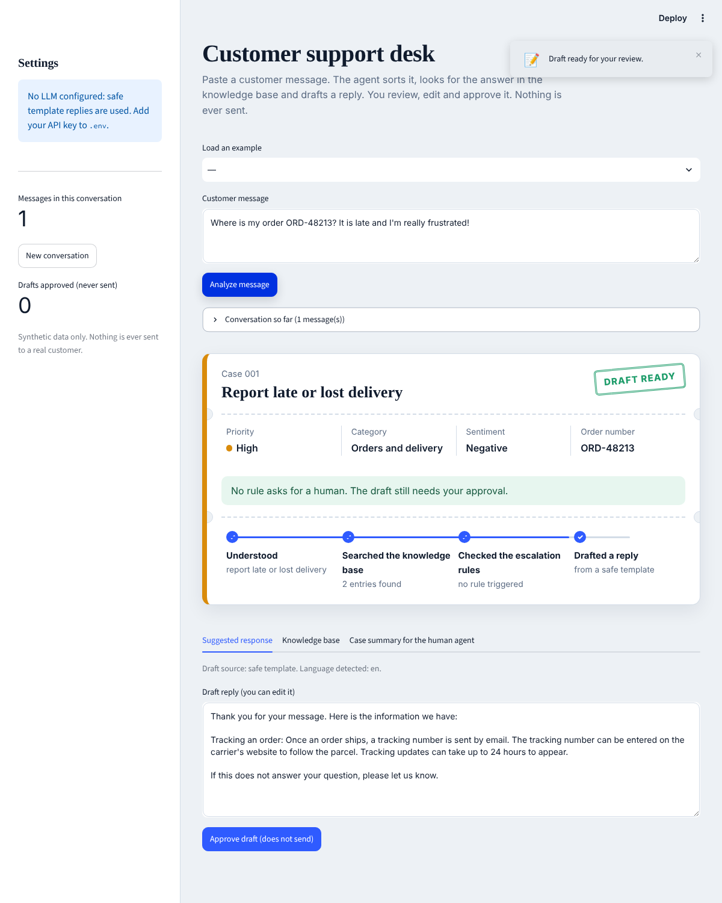
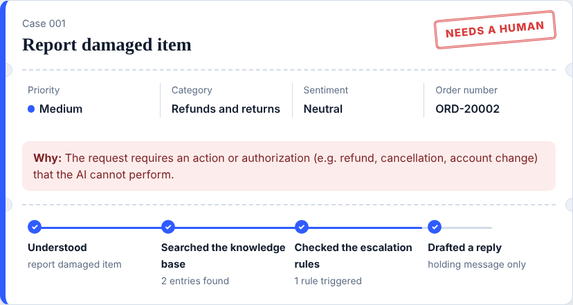

# AI Customer Support Agent

An AI assistant that reads a customer message, finds the answer in a knowledge base, drafts a polite reply, and **hands sensitive cases to a human**. Nothing is ever sent to a customer: a person reviews and approves every reply.

Built with Python, Pydantic, Google Gemini, Streamlit, FastAPI and n8n. It uses a fictional shop ("NovaShop") and synthetic data only.

<p align="center">
  
</p>

## What it does

- **Understands the request.** Intent, category (product, orders and delivery, refunds and returns, technical support, complaint, other), priority, sentiment, language (English or French) and order number.
- **Answers from facts only.** It searches a local JSON knowledge base and writes the reply from the entries it found. If nothing reliable is found, it escalates instead of guessing.
- **Escalates when it should.** A human takes over for fraud or privacy issues, explicit requests for a person, refunds or cancellations, billing disputes, missing information, and customers who stay unhappy.
- **Briefs the human agent.** Each escalation comes with a short case summary: why it was escalated, the latest messages, related knowledge base entries and recommended next steps. E-mails, card numbers and phone numbers are masked.
- **Keeps a human in the loop.** The Streamlit app and the n8n workflow both stop and wait for a person to approve, edit or reject the draft.

<p align="center">
  
</p>

## How it works

```
Customer message
      |
      v
 1. Classify ------ intent, category, priority, sentiment, language, order number
      |
      v
 2. Search --------- knowledge base (keyword scoring, swappable for embeddings)
      |
      v
 3. Escalation rules  fraud / human requested / refund or cancellation /
      |               billing dispute / no reliable information / repeated anger
      |
      +-- needs a human --> holding message + case summary (the LLM is never called)
      |
      v
 4. Draft the reply  Gemini, using only the retrieved entries
      |               checked afterwards: known entries only, no promises
      |               on any problem: safe template built from the entry itself
      v
 5. A person reviews, edits and approves   (nothing is sent)
```

## Tech stack

| Area | Tool |
|---|---|
| Language | Python 3.11+ |
| Validation and structured output | Pydantic v2 |
| LLM | Google Gemini through Google AI Studio (`google-genai` SDK) |
| Interface | Streamlit |
| Local API | FastAPI and Uvicorn |
| Automation | n8n (runs in Docker ) |
| Tests | Pytest, 288 tests, no network access needed |

## Quick start

```bash
git clone <your-repository-url>
cd customer-support-agent

python -m venv .venv
# Windows PowerShell:  .venv\Scripts\Activate.ps1
# macOS / Linux:       source .venv/bin/activate

pip install -r requirements.txt
python -m pytest
python main.py
```

Without an API key the agent still works: it answers with safe templates built from the knowledge base. Add a key to get replies written by the LLM.

### Configuration

Copy `.env.example` to `.env` and fill in your values. The `.env` file is ignored by Git.

| Variable | Purpose | Default |
|---|---|---|
| `LLM_PROVIDER` | LLM provider (`gemini` is supported) | `gemini` |
| `LLM_API_KEY` | Google AI Studio API key | none (template replies) |
| `LLM_MODEL` | Exact model id shown in AI Studio | `gemini-3.8-flash` |
| `LLM_TIMEOUT_SECONDS` | Maximum wait for the LLM | `20` |
| `SUPPORT_API_KEY` | Key that n8n sends to the local API | empty (local use only) |
| `LOG_LEVEL` | Log verbosity | `INFO` |

## Usage

### Command line

```bash
python main.py "Where is my order ORD-12345?"
python main.py --no-llm          # force template replies
```

### Streamlit interface

```bash
streamlit run app.py
```

Paste a customer message and the app shows the case as a ticket: priority, status stamp, reason for escalation, and a four-step decision trail. Review the knowledge base entries, edit the draft, then approve it. Approving only saves the draft in the session and never sends it.

### Local API for automation

```bash
python -m uvicorn src.api:create_app --factory --host 127.0.0.1 --port 8000
```

| Route | Purpose |
|---|---|
| `GET /health` | Is the API up, is the LLM configured |
| `POST /analyze` | Analyse a message; the `route` field tells the workflow where to go |
| `POST /escalations` | Record an escalated case (sensitive data masked) |
| `POST /approved-replies` | Record a reply approved by a person. This is a simulated send: `sent` is always `false` |

Interactive documentation is available at `http://127.0.0.1:8000/docs`.

### n8n workflow

`n8n/support_agent_workflow.json` receives a request, calls the API, routes sensitive cases to a human, and pauses on an approval form before anything is saved to the simulated outbox. Step-by-step setup, including Docker, is in [`n8n/SETUP.md`](n8n/SETUP.md).

## Responsible AI and security

- **No invented facts.** Replies use only retrieved knowledge base entries. A reply that cites an unknown entry, is empty or too long, or promises a refund, cancellation or guarantee is rejected, and a safe template is used instead.
- **No unauthorised actions.** The agent never claims that a refund, cancellation or account change has been done. Cases that need an authorisation are escalated and never reach the LLM.
- **Untrusted input.** Customer messages and documents are placed between tags, and the model is told never to follow instructions found inside them. HTML in messages is displayed as plain text.
- **Privacy.** Case summaries and saved logs mask e-mails, card numbers and phone numbers. Application logs contain metadata only (intent, priority, route), never message text. Runtime files go to `data/runtime/`, which is ignored by Git.
- **Secrets.** API keys live in `.env` or in environment variables, never in the code or the workflow file.
- **Human approval.** The app and the workflow both require a person before any reply is considered approved, and no code path sends a message to a customer.

## Testing

```bash
python -m pytest
```

288 tests cover the models, classification, retrieval, escalation rules, case summaries, LLM guard rails with fake clients, the API, the workflow file, the Streamlit app, realistic English and French scenarios, odd inputs, LLM failures and log redaction. The tests never call a real LLM, so they run without any key (and in the GitHub Actions workflow in `.github/workflows`).

## Project structure

```
.
├── app.py                    Streamlit interface
├── main.py                   Command line entry point
├── src/
│   ├── models.py             Pydantic models and enums
│   ├── classifier.py         Intent, priority, sentiment, language, order number
│   ├── keywords.py           Text normalisation and keyword lists
│   ├── knowledge_base.py     Loading and searching the knowledge base
│   ├── escalation.py         Escalation rules
│   ├── handoff.py            Case summary for the human agent, data masking
│   ├── llm_client.py         Gemini client behind a small interface
│   ├── response_generator.py Prompt, reply checks and safe templates
│   ├── analyzer.py           The full pipeline
│   ├── api.py                FastAPI app used by n8n
│   ├── config.py             Settings from .env
│   ├── logging_config.py     Logs with sensitive data masked
│   └── ui_helpers.py         HTML pieces of the interface
├── assets/style.css          Interface styles
├── data/knowledge_base.json  Fictional knowledge base
├── n8n/                      Workflow and setup guide
├── tests/
└── docs/screenshots/
```

## Limitations and next steps

- Retrieval uses keyword scoring, so it does not understand meaning. The search sits behind a single method and can be replaced by embeddings and a vector database.
- Language detection and classification are rule based, for English and French only.
- Approved drafts are kept for the session (Streamlit) or in a local file (API). A real deployment would need a database, user accounts and an audit trail.
- The workflow ends in a simulated outbox. Connecting a real channel (Gmail, Slack, Telegram) should keep the approval step.

